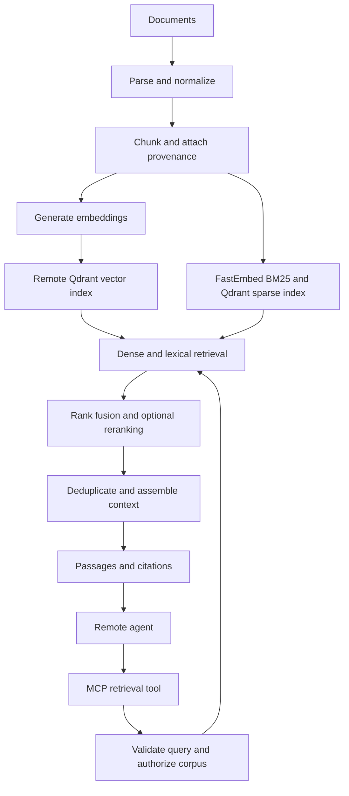

# Python RAG Service Implementation Plan

Date: 2026-11-05  
Status: Proposed prototype plan

Accepted lifecycle update: [incremental ingestion and generation lifecycle](docs/INCREMENTAL_INGESTION.md).
That design supersedes full-generation rebuilds as the planned default for ordinary updates;
explicit full rebuilds remain for processing changes. Implemented for a single-host coordinator; distributed coordination remains future work.

## 1. Objective and scope

Build a Python service that ingests documents, retrieves relevant evidence, and exposes cited context to remote agents through MCP.

The primary MCP tool returns passages and source metadata. The calling agent owns final prompt construction and answer generation. An optional answer-generation tool can be added later; an internal generative LLM is not required for the initial service.

Initial assumptions:

- English Markdown, plain text, and text-based PDFs.
- One ingestion worker with persistent workspace storage and a remote Qdrant service; query/MCP
  workers deploy independently.
- Local embedding and reranking models.
- A bounded corpus suitable for an in-memory BM25 baseline.
- Administrative ingestion through a CLI; remote agents receive read-only tools.

Confirm corpus size, languages, hardware, privacy requirements, and access-control needs before finalizing model choices and performance targets. OCR, complex table extraction, fine-tuning, and distributed deployment are outside the initial scope.

## 2. Architecture



Keep ingestion, retrieval, context assembly, and MCP transport separate. Tests, the CLI, and the evaluation runner should invoke the same retrieval service as MCP.

## 3. Tools and dependencies

| Component | Proposed choice | Purpose |
|---|---|---|
| Runtime | Python 3.12+ | Application implementation |
| Environment | uv, pyproject.toml, committed lockfile | Reproducible installation |
| Schemas | Pydantic | Configuration, metadata, request, and response validation |
| Parsing | Text readers, Markdown parser, pypdf | Initial supported document formats |
| Embeddings | sentence-transformers | Model loading, tokenization, and batching |
| Embedding baseline | BAAI/bge-small-en-v1.5 | Lightweight English retrieval baseline |
| Vector store | Qdrant Cloud or remote Qdrant, official qdrant-client | Server indexing, search, payloads, and filtering |
| Lexical retrieval | FastEmbed/Qdrant BM25 with Qdrant sparse indexing | Existing lexical algorithms; shared remote storage |
| Reranker | cross-encoder/ms-marco-MiniLM-L6-v2 | Query–passage relevance scoring |
| Manifest | SQLite worker audit/cache; Qdrant metadata and alias | Remote index discovery independent of local files |
| MCP | Official Python MCP SDK | Tool schemas and remote transport |
| Quality | pytest, Ruff, mypy | Tests, linting, and type checking |
| Evaluation | Python CLI, JSONL, pandas | Reproducible experiments and reports |
| Deployment | Managed remote Qdrant plus containerized application | Independent storage, ingestion, and MCP lifecycles |

Pin released package versions and model revisions during implementation. Use documentation matching the selected MCP SDK release; do not combine examples from different major versions.

BGE-small-en-v1.5 produces 384-dimensional embeddings and accepts up to 512 tokens. It is an initial baseline, not a presumed best model for the dataset. See the [model card](https://huggingface.co/BAAI/bge-small-en-v1.5).

Use direct Python modules initially. Introduce an orchestration framework only if a concrete requirement justifies it.

## 4. Data model and storage

### Document record

- Stable document ID and source URI.
- Title, language, and content hash.
- Document version and ingestion timestamp.
- Parser and chunker versions.
- Collection and authorization metadata.
- Ingestion state: pending, indexing, ready, or failed.

### Chunk record

- Deterministic chunk ID, document ID, and document version.
- Chunk position, text, title, and heading path.
- Page numbers or offsets into a versioned normalized source.
- Token count and embedding model revision.
- Collection and authorization metadata.

Store vectors, chunk text, and retrieval metadata in remote Qdrant. Put original files in versioned
object storage for deployment; local disk is the initial ingestion staging area. SQLite records the
worker audit and embedding cache. Qdrant collection metadata and an atomic alias own the published
index identity; MCP readers must not depend on the worker's SQLite file.

Dense and future sparse indexes must represent the same corpus generation. Build and verify a new
Qdrant collection, then switch the active alias using Qdrant's atomic alias API. Each query resolves
and pins one physical generation throughout. Retain the previous generation until in-flight requests
finish. Use a single ingestion writer per corpus; the local file lock is not a distributed lock.

Use the official SDK's `query_points`, payload indexes, and future `Prefetch`/`FusionQuery` operations.
Do not implement local nearest-neighbor indexing or ranking algorithms. See
[the remote storage design](docs/REMOTE_STORAGE.md) for current capabilities and deployment setup.

Skip unchanged documents using content hashes. Use deterministic IDs for retry-safe writes. Changed embedding models require a new compatible index and re-embedding, even when vector dimensions match.

## 5. Ingestion implementation

Pipeline:

```text
load → parse → normalize → chunk → embed → index → validate → publish
```

1. Read documents from an explicitly configured local input directory.
2. Validate file type and size; record extraction failures.
3. Normalize whitespace while preserving headings and provenance.
4. Chunk using the model tokenizer.
5. Generate embeddings in bounded batches using the model's documented query/document conventions.
6. Store vectors and payloads; build the corresponding lexical index.
7. Verify expected document and chunk counts before publishing the generation.
8. Record timings, hashes, versions, and errors in the manifest.

Detect scanned or poorly extracted PDFs and report them as unsupported or requiring OCR. Do not silently publish empty or garbled text.

Support CLI operations for ingestion, status inspection, document deletion, and index rebuilding. Test interrupted ingestion and safe retries.

## 6. Chunking implementation

Use semantic chunking plus recursive character splitting, as requested during implementation:

1. Preserve Markdown section boundaries and segment the body into sentences.
2. Embed bounded sentence contexts on each side of a candidate boundary, without crossing it.
3. Detect topic changes using cosine distance, a configurable percentile, and an absolute distance floor.
4. Keep coherent groups intact when they fit the model budget.
5. Split oversized groups with LangChain's `RecursiveCharacterTextSplitter`: paragraphs, lines,
   sentence punctuation, whitespace, punctuation, and finally characters.
6. Preserve source offsets and semantic group IDs. Optional overlap uses complete sentences within
   a group and never crosses a semantic boundary.

Initial settings: a 300-token hard ceiling, zero overlap, 85th-percentile breakpoints, minimum
cosine distance 0.1, and two sentences on each side of a boundary. These require evaluation, not
assumption of improved retrieval. Sentence contexts are bounded before embedding, and final chunks
are verified against the actual tokenizer. Semantic and final embeddings share a cache.

Use `preview-chunks` to inspect outputs without indexing. Retain the token-window baseline for
comparison. Compare evidence coverage, boundary quality, retrieval recall, and ingestion cost before
embedding the full BioASQ corpus. See [the chunking design](docs/CHUNKING.md).

## 7. Retrieval and ranking

Implement interchangeable dense, lexical, and reranker interfaces, plus one retrieval service that coordinates them.

| Mode | Behavior | Purpose |
|---|---|---|
| BM25 only | Lexical ranking | Evaluation baseline |
| Dense only | Query embedding and vector search | First working retrieval pipeline |
| Hybrid | Dense and BM25 with reciprocal rank fusion | Semantic and exact-term coverage |
| Hybrid plus reranker | Hybrid candidates scored by a cross-encoder | Improve final evidence ordering |

Starting parameters:

- Retrieve 30 dense and 30 lexical candidates.
- Deduplicate by chunk ID and combine rankings using reciprocal rank fusion.
- Rerank up to 40 unique candidates.
- Return at most 6 passages within the context budget.

Treat these values as experiment parameters. Do not directly add raw dense, BM25, and reranker scores or present them as confidence probabilities. Qdrant documents [hybrid queries and reciprocal rank fusion](https://qdrant.tech/documentation/hybrid-queries/).

A cross-encoder evaluates query–passage pairs jointly. It can reorder candidates but cannot recover evidence absent from the candidate set. See [Sentence Transformers retrieve-and-rerank documentation](https://www.sbert.net/examples/sentence_transformer/applications/retrieve_rerank/README.html).

Authorize the requested corpus before searching. Apply all applicable metadata and access filters to both retrieval branches before candidate selection. A separate authorized corpus collection is a simple initial boundary. If per-document permissions are introduced, implement equivalent preselection in the lexical branch.

## 8. Context assembly and optional generation

Implemented: budgeted citation-preserving assembly, provider-neutral optional generation,
versioned grounding prompt, structural citation validation, and exact dataset inventory.
See [implementation and dataset overview design](docs/CONTEXT_AND_GENERATION.md).
A concrete generation provider and hierarchical semantic corpus summaries remain future work.

The assembler should:

- Remove duplicate or heavily overlapping passages.
- Preserve passage boundaries and citation IDs.
- Include document title, version, source URI, and location.
- Select evidence within the requested budget and server-side limits.
- Report omitted or truncated results.
- Preserve enough metadata to fetch surrounding evidence later.

Use a configured tokenizer for context budgeting. If the calling agent's tokenizer is unknown, label token counts as estimates and also enforce a hard serialized response-size limit.

For an optional answer tool, maintain a versioned prompt that instructs the model to answer from evidence, cite supporting passages, acknowledge insufficient evidence, and treat retrieved text as data rather than instructions. Delimit source content clearly. Prompt wording alone is not a security boundary.

An empty result and an unanswerable question are different states. Do not infer answerability solely from an arbitrary similarity threshold. Evaluate and calibrate any abstention policy on labeled data.

## 9. MCP contract and remote deployment

Initial tool:

```python
retrieve_context(
    query: str,
    collection: str,
    top_k: int = 6,
    max_context_tokens: int = 2500,
    filters: dict | None = None,
) -> RetrievalResult
```

The implementation should replace unrestricted filter dictionaries with a validated allowlisted schema. Bound query length, top_k, response size, and execution time.

Example response:

```json
{
  "query": "How long are backups retained?",
  "index_version": "corpus-v3",
  "passages": [
    {
      "citation_id": "S1",
      "chunk_id": "backup-policy-v2-004",
      "document_id": "backup-policy",
      "document_version": "v2",
      "text": "Daily backups are retained for 30 days.",
      "source": {
        "title": "Backup Policy",
        "uri": "docs/backup-policy.md",
        "section": "Retention"
      }
    }
  ],
  "truncated": false,
  "warnings": []
}
```

Possible later tools:

- `get_document_excerpt(document_id, location)` with the same authorization checks.
- `answer_question(...)` if the service should own generation.

Use Streamable HTTP for remote clients and optionally stdio for local development. References: [Python SDK transport documentation](https://py.sdk.modelcontextprotocol.io/run/) and [structured output documentation](https://py.sdk.modelcontextprotocol.io/v2/servers/structured-output/).

Before remote exposure, implement TLS, authentication compatible with the chosen MCP clients, token validation, per-corpus authorization, rate limits, and timeouts. Derive access scope from authenticated identity; caller filters may narrow but never broaden it. Keep administrative mutations out of the initial remote tool surface.

Load models once at startup. Run blocking inference through bounded workers so it does not block the transport event loop. Add health/readiness checks and graceful shutdown.

Log request IDs, index versions, candidate counts, stage timings, and error categories. Avoid logging full source passages, credentials, or sensitive queries by default.

## 10. Testing plan

Tests establish software correctness; evaluation measures retrieval usefulness.

| Layer | Cases |
|---|---|
| Parsing | Empty files, Unicode, malformed PDFs, headings, tables, extraction failures |
| Chunking | Token limits, stable IDs, overlap, source mapping, oversized sections |
| Embeddings | Batch ordering, vector dimensions, model revision mismatch, input limits |
| Index lifecycle | Duplicate ingestion, updates, deletions, interrupted writes, restart recovery, generation consistency |
| Retrieval | Exact terms, paraphrases, filters, candidate deduplication, empty corpus |
| Context | Budget enforcement, citation integrity, overlap removal, truncation |
| Access control | Unauthorized corpus, forbidden excerpts, filter bypass attempts |
| Failure handling | Unavailable vector store, inference errors, timeouts, invalid input |
| MCP | Initialize, list tools, call tool, structured responses, cancellation, errors |
| End to end | Ingest fixture corpus, call real MCP client, verify expected evidence and provenance |

Use fake embeddings for deterministic logic tests and a small real-model integration suite with Qdrant. Fake embeddings cannot validate semantic retrieval quality.

Performance checks:

- Cold-start versus warm-query latency.
- p50/p95 total latency and per-stage timings.
- Ingestion throughput and peak memory.
- Small concurrent workloads and bounded queue behavior.
- Response size, reranking cost, and recovery after dependency failure.

Run unit tests and static checks on routine changes. Run integration and end-to-end tests for retrieval, storage, or MCP changes. Keep expensive evaluation separate and reproducible.

## 11. Evaluation dataset

Start with approximately 100–200 representative questions if available. A smaller manually verified seed set is sufficient to begin implementation.

Include direct facts, paraphrases, exact identifiers, domain terminology, multiple-evidence questions, ambiguity, unanswerable questions, conflicting versions, and instruction-like source content.

Suggested JSONL record:

```json
{
  "query_id": "q001",
  "query": "How long are daily backups retained?",
  "answerable": true,
  "reference_answer": "30 days",
  "evidence": [
    {
      "document_id": "backup-policy",
      "document_version": "v2",
      "section": "Retention",
      "quote": "Daily backups are retained for 30 days."
    }
  ],
  "tags": ["single_passage", "policy"]
}
```

Anchor labels to versioned source evidence rather than generated chunk IDs. Map evidence to chunks for each experiment using source locations and verified text matching. This allows fair chunker comparisons.

Split into development and held-out test questions; group near-duplicates together. Tune only on development data. The retrieval corpus still contains documents required to answer held-out questions. Add a separate unseen-document experiment later if that generalization question matters.

The most useful user-provided package includes source documents, representative questions, supporting passages, reference answers where available, and corpus language and size.

## 12. Evaluation metrics and experiments

| Area | Metrics |
|---|---|
| Candidate retrieval | Evidence Recall@20/50; all-evidence coverage for multi-passage questions |
| Final ranking | nDCG@5/10; MRR for questions with one principal evidence passage |
| Assembled context | Evidence coverage within budget, redundancy, source-location accuracy |
| Optional generation | Answer correctness, groundedness, citation precision and completeness |
| Insufficient evidence | Abstention precision/recall and false-answer rate |
| Operations | p50/p95 latency, throughput, memory, indexing duration, query cost |

Define evidence relevance consistently. Overlapping chunks supporting the same fact must not count as multiple distinct evidence items. Report retrieval metrics on answerable questions and evaluate unanswerable questions separately.

Compare on the same corpus and question split:

1. BM25 only.
2. Dense only.
3. Hybrid retrieval.
4. Hybrid plus reranking.
5. Best retrieval setup with alternative chunk sizes and overlap.

Record corpus hash, code revision, package lockfile, model revisions, chunking settings, retrieval parameters, prompt version if applicable, and timings for every run. Inspect failures by query category. Report uncertainty when the dataset is small; do not treat tiny score differences as reliable improvements.

Use human review as the reference for a representative sample. An LLM judge may assist answer evaluation, but validate its judgments against human labels and fix its model and prompt across comparisons.

Provisional acceptance targets, to revise after a baseline run:

- At least 90% evidence Recall@20 on answerable questions.
- Correct source mapping for every returned citation in the verification set.
- Zero unauthorized passages in access-control tests.
- No material quality regression from enabling reranking; retain it only when the quality/latency tradeoff is worthwhile.
- A measured p95 latency target set against the actual corpus, hardware, and concurrency requirements.

These are proposed gates, not promised results.

## 13. Delivery milestones

| Phase | Deliverables | Exit criterion |
|---|---|---|
| 1. Foundation | Repository, configuration, schemas, fixture corpus, evaluation seed set | Reproducible environment and basic CLI |
| 2. Ingestion | Parsing, chunking, provenance, embeddings, versioned indexing | Retry-safe ingestion; updates and deletions verified |
| 3. Baseline retrieval | Dense search, filters, citations, budgeted context | Measured baseline with traceable evidence |
| 4. MCP vertical slice | Retrieval tool, local and remote transport tests | Real MCP client retrieves context |
| 5. Quality experiments | BM25, fusion, reranker, chunking comparisons | Measured choice of default configuration |
| 6. Remote readiness | Authentication, authorization, limits, packaging, observability | Remote client works within access scope and resource limits |
| 7. Evaluation handoff | Held-out report, regression cases, runbook | Another developer reproduces behavior and results |

Prioritize a complete documents → retrieval → citations → MCP path before optimizing ranking. Add optional generation only when ownership of answers is explicitly required.

## 14. Proposed repository layout

```text
rag-service/
├── pyproject.toml
├── uv.lock
├── compose.yaml
├── config/
├── src/rag_service/
│   ├── config.py
│   ├── schemas.py
│   ├── ingestion/
│   ├── chunking/
│   ├── embeddings/
│   ├── storage/
│   ├── retrieval/
│   ├── reranking/
│   ├── context/
│   ├── mcp_server.py
│   └── cli.py
├── tests/
│   ├── unit/
│   ├── integration/
│   └── e2e/
└── evaluation/
    ├── datasets/
    ├── run.py
    ├── metrics.py
    └── reports/
```

## 15. Decisions to confirm before implementation

- Corpus formats, languages, size, and update frequency.
- Target machine, available memory, and GPU availability.
- Required remote MCP clients and authentication environment.
- Whether access is corpus-wide or document-specific.
- Whether documents may leave the deployment environment.
- Whether the service should generate answers or only supply evidence.
- Available testing documents, questions, and evidence annotations.

These decisions do not block writing the initial schemas, fixture corpus, CLI skeleton, and evaluation format using the assumptions above.
