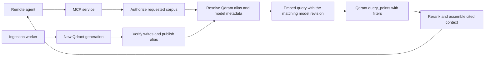

# Remote storage and retrieval deployment

## Decision

Target the user's **existing remote Qdrant server**, using the official `qdrant-client` Python SDK.
Read-only connectivity confirmed server/client version 1.20.0 and an empty server; no knowledge-base
data was uploaded. Credentials reside in ignored local `.env`, not the example template.

The accepted next implementation is documented in [incremental ingestion and generation lifecycle](INCREMENTAL_INGESTION.md).
It introduces incremental active-collection updates, controlled ingestion windows, and one inactive
fallback. The whole-generation behavior described below remains the current implementation.

The previous smoke index used Qdrant's official embedded/local implementation at `.data/qdrant`.
That is useful for deterministic correctness tests, but it is not the production Qdrant server and
does not establish server indexing performance. Embedded mode now requires `--storage embedded`.
Normal ingestion fails if a remote URL is missing; it never silently falls back to local storage.

## What lives where

| Data | Deployment location | Current implementation |
|---|---|---|
| Dense embeddings | Remote Qdrant collection | Official SDK create/upsert |
| Chunk text, citations, source offsets, semantic group IDs | Qdrant point payloads | Stored with every vector |
| Active index version | Qdrant collection alias | Atomic alias publication |
| Embedding model/revision and corpus counts/hash | Qdrant collection metadata | Available to independent readers |
| Original source files and normalized exports | Versioned object storage in deployment | Currently local staging; object-storage adapter is future work |
| Embedding cache and ingestion audit | Ingestion worker's persistent work volume | SQLite; not required by query/MCP workers |
| Sparse/BM25 vectors | Same remote Qdrant service | Planned hybrid-search milestone |

Local `.data/` is a worker workspace, not a database directory that the MCP server must mount.
It still holds reusable embedding-cache values and ingestion artifacts. Query workers obtain
searchable text and citations directly from Qdrant. For local-file sources, replace laptop-specific
`file://` source URIs with accessible, appropriately authorized source links before deployment.

## Algorithms supplied by existing tools

| Function | Implementation owner |
|---|---|
| Dense vector indexing and nearest-neighbor search | Qdrant server: HNSW, index optimizers, and its query planner |
| Metadata filtering | Qdrant payload indexes and filter API |
| Sparse indexing/search, later | Qdrant sparse index |
| BM25 sparse encoding, later | Existing FastEmbed/Qdrant BM25 implementation |
| Hybrid rank fusion, later | Qdrant `Prefetch` and `FusionQuery` APIs |
| Cross-encoder reranking, later | Sentence Transformers `CrossEncoder` |
| Recursive splitting | LangChain `RecursiveCharacterTextSplitter` |

The application handles schemas, provenance, orchestration, and configuration. It does not implement
HNSW, nearest-neighbor scans, BM25 scoring, or reciprocal rank fusion itself. Server defaults are the
starting point; Qdrant may choose a scan for small collections or selective filters. Tune index
parameters only after measuring remote latency and recall on the actual corpus.

The current search adapter supports dense vector queries and document-ID filters. Hybrid search,
query-text embedding orchestration, reranking, and the MCP adapter are not implemented yet.

## Query path for a future MCP deployment



The query adapter already delegates the actual retrieval operation to the SDK:

```python
index = store.active_index("bioasq")
if index is None:
    raise ValueError("No published index")

# The future retrieval service creates query_vector using index.embedding.model/revision.
# Resolve once and pin this generation for all stages of a single request.
hits = store.search(index.generation_id, query_vector, limit=6)
```

Internally, `search` calls `QdrantClient.query_points` with the query vector, filters, limit, and
`with_payload=True`. It maps the returned scores and chunks into typed results; it does not compute
similarities or reorder hits. The caller must use the matching embedding model, not merely one with
the same vector dimension. MCP authorization must determine accessible corpora/documents before
calling this adapter; a caller-provided filter is not an authorization policy.

## Configure the connection

Use a Qdrant server compatible with the locked 1.20-series client and collection metadata API.
Choose the cloud region near the future MCP host, and size the cluster after measuring the actual
semantic chunk count and payload size. Configure separate ingestion write credentials and query
read credentials with access to the necessary collection metadata and aliases.

Set `QDRANT_URL` and `QDRANT_API_KEY` in the process environment or deployment secret manager.
See `.env.example` for variable names; the CLI does not automatically load that file. Do not put the
key in a command-line argument or send it in chat.

```sh
source .venv/bin/activate

# Read-only connectivity and index-metadata check; no model is loaded.
rag storage-status --collection bioasq

# After reviewing chunking and selecting the actual source set:
rag ingest --documents PATH_TO_DOCUMENTS_JSONL --collection bioasq

# Explicit development-only alternative:
rag ingest --storage embedded --directory tests/fixtures/documents --collection example
```

`--qdrant-url` overrides `QDRANT_URL`; `--qdrant-timeout` defaults to 30 seconds. Settings redact API
keys, including validation errors. `rag status` is local ingestion history;
`rag storage-status` is the authoritative remote active-index view. The original local smoke index
predates remote alias publication and has not been migrated automatically.

## Publication and failure behavior

Build one physical collection per corpus generation, store its model metadata, upload all chunks,
and verify its count. Then switch `rag_active_COLLECTION` using Qdrant's atomic alias-operation API.
The metadata and points are already present before that generation becomes discoverable. Keep
previous generations until requests pinned to them finish; automated garbage collection is future work.

SQLite records the ingestion audit after remote publication. A failed publication response may be
ambiguous: the server might have committed the alias. Such a run is marked `publication_pending`,
not automatically treated as a failed index. A subsequent run reconciles it when the alias confirms
the generation. If it cannot confirm that state, ingestion stops for operator inspection rather
than issuing another blind switch. The remote alias remains the source of truth.

Use **one ingestion writer per corpus** in the deployment scheduler. The local file lock only protects
one work directory; it is not a distributed lock, and Qdrant alias updates are not a compare-and-swap
writer-election mechanism. Multiple MCP readers are independent of that writer.

## Verification and remaining deployment work

Tests cover SDK parameter forwarding, credential redaction, ranking/filtering through Qdrant's local
test engine, publication, generation pinning, an independent local ledger, and lost-response recovery.
These do not certify a cloud connection, network performance, or server HNSW behavior.

An opt-in real-server test is available with `RAG_TEST_QDRANT_URL` and
`RAG_TEST_QDRANT_API_KEY`. Use a disposable test cluster: it creates a uniquely named tiny fixture
collection, queries it, and removes it afterward. Run `pytest -m remote`. It is skipped unless the
test-specific endpoint is configured, and it never uses `QDRANT_URL` implicitly.

Before a full knowledge-base ingest: connect the selected cluster, run the read-only status check,
run the remote fixture test, review representative semantic chunks, then decide the corpus/index
configuration. Deploying the MCP service and moving raw documents to object storage are later steps.

## Official references

- [Qdrant Cloud setup](https://qdrant.tech/documentation/cloud-quickstart/)
- [Authentication](https://qdrant.tech/documentation/cloud/authentication/)
- [Indexing and query planning](https://qdrant.tech/documentation/manage-data/indexing/)
- [Collection metadata API](https://api.qdrant.tech/api-reference/collections/create-collection)
- [Atomic collection aliases](https://qdrant.tech/documentation/manage-data/collections/)
- [Query API](https://api.qdrant.tech/api-reference/search/query-points)
- [Hybrid queries](https://qdrant.tech/documentation/hybrid-queries/)
